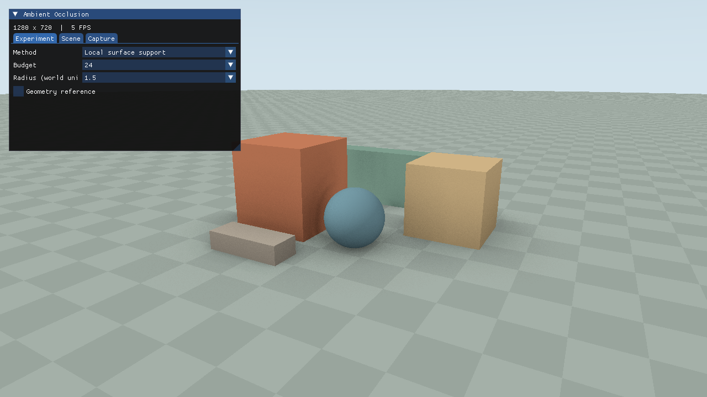

# gfx-research-ambient-occlusion

A controlled OpenGL experiment on **occluder thickness in screen-space ambient occlusion**. The candidate assigns a depth slab to each prospective blocker from four nearby surface samples. It targets excessive darkness around thin rails while preserving contact between objects and the floor.



## Hypothesis and methods

The primary comparison is local surface support versus a medium fixed slab. At a radius of 1.5 world units and 24 directions, does the candidate reduce mean absolute error at object silhouettes? Monitor floor-contact MAE at the same time. An increase above 0.01 in linear accessibility is the prespecified material contact penalty.

| Method ID | Depth model |
|---|---|
| `slab-thin` | Constant thickness of 0.06 times the radius |
| `slab-mid` | Constant thickness of 0.25 times the radius, primary comparator |
| `slab-thick` | Constant thickness of 0.75 times the radius |
| `local-support` | Thickness from the weaker of horizontal and vertical surface support |
| `horizon` | Tangent-frame horizon control, six radial samples per azimuth |
| `pooled-support` | Same four neighbors as the candidate, with pooled support across both axes |

For the slab methods the same cosine-weighted rays sample six points per direction. At a potential blocker the local rule measures agreement with the tangent plane and normal of each of four adjacent texels. The weaker-axis score is `c = min(h, v) / 2`, where each count is 0, 1 or 2. The slab thickness is `R * (0.06 + 0.69 * c²)`. A thin foreground silhouette can still belong to a thick object. The recessed-steps and contact scenes exercise this ambiguity.

The reference traces the complete analytic scene and integrates finite-radius accessibility. The publication profile uses two independently shifted sets of 512 cosine-weighted directions per pixel. It saves both shift images and their pooled mean. The `horizon` control implements the formula described in the article. Full HBAO, GTAO and XeGTAO pipelines are related work.

## Scene and evaluation matrix

| Scene | Purpose |
|---|---|
| `contacts` | Box and sphere contacts, a low step and a rear wall |
| `slats` | Thin upright rails, horizontal crosspiece and a nearby foreground shelf |
| `cavity` | Recessed steps, narrow channel and an overhanging slab |
| `frustum-edge` | Occluders moving toward the image edge under a change of camera |
| `empty-plane` | Null test. Every valid floor pixel must have accessibility 1 |

The quality suite uses three fixed cameras, radii 0.75 and 1.5, and budgets of 8 and 24 directions. Captures use 640 × 360 pixels. The paper profile has **25 quality cases, 300 method images with accompanying raw buffers, and 28,800 raw timing queries**. The isolated plane has one camera and one radius. Times use the contact and rail scenes at radius 1.5.

### Recorded quantities

- `edge_mae` is the primary endpoint. Both sides of a four-neighbor ID transition involving a solid are included when the receiver is valid. The finite ground-to-sky horizon is excluded.
- `contact_mae` measures floor pixels within 0.20 times the AO radius of the nearest solid. `border_mae` measures the outer 5% of either screen dimension. The masks overlap.
- Regional absolute errors, excess darkening, whole-image RMSE, signed bias, mean depth probes and extra neighbor comparisons are available in the CSV. Empty regions are blank and carry a pixel count of zero.
- `reference.npz` stores `signal`, both `reference_shifts`, `position_id`, `normal_contact`, `details` and the boolean region masks. Each method's `raw.npz` stores the linear scalar image and RGBA diagnostics (valid receiver, depth probes, tested in-bounds neighbors, reserved). In `regions.png`, red is the edge, green is floor contact and blue is the border.
- The primary summary gives each of the four challenge scenes equal weight after averaging its three camera views. The paired difference is candidate minus medium slab. Negative edge MAE differences favor the candidate.

## Run on Windows

The automated runner uses Python 3.10 or later and a desktop OpenGL 4.3 context. It compiles the same GLSL files as the native viewer. The following PowerShell commands run from the extracted project directory.

```powershell
py -3 -m venv .venv
.\.venv\Scripts\python.exe -m pip install -r requirements.txt
.\.venv\Scripts\python.exe tools/study.py run --profile smoke --out runs/smoke
```

To run the hardware series on a Radeon RX 9070 XT and import the results into the companion paper, extract the two archives side by side. The optional renderer check verifies the active adapter. The command log and detected device are retained in the run manifest.

```powershell
.\.venv\Scripts\python.exe tools/study.py run --profile paper --out runs/rx9070xt --expect-renderer "9070 XT"
.\.venv\Scripts\python.exe tools/study.py analyze runs/rx9070xt --paper ../gfx-research-ambient-occlusion-paper
```

Run the same command with `--resume` to continue an interrupted recording. Complete cases are verified and reused. A changed plan, code hash or device requires a fresh output directory. The working directory can contain spaces. Linux uses `.venv/bin/python` and EGL by default. On Windows the offscreen runner uses the default WGL context. On systems with multiple EGL devices, `--device INDEX` selects an adapter. Run `tools/study.py plan --profile paper` to print the entire case matrix without creating a graphics context.

| Profile | Intended use | Quality size | Timing size | Blocks × measured draws, per method and timing case |
|---|---|---|---|---|
| `smoke` | Validate the data and report pipeline on all five scenes | 144 × 80 | 144 × 80 | 1 × 3 |
| `quick` | Inspect camera, budget and parameter sensitivity | 320 × 180 | 640 × 360 | 3 × 10 |
| `paper` | Record the declared hardware suite | 640 × 360 | 1280 × 720 and 1920 × 1080 | 5 × 40 |

## Interactive viewer

The C++20 viewer uses CMake 3.25+, an OpenGL 4.6 core driver and `gfx-research-base v0.3`. First configuration downloads the base and its dependencies. With Ninja and a C++ toolchain on PATH:

```powershell
cmake -S . -B out/build -G Ninja -DCMAKE_BUILD_TYPE=Release "-DPython3_EXECUTABLE=$PWD/.venv/Scripts/python.exe"
cmake --build out/build --parallel
ctest --test-dir out/build --output-on-failure
.\out\build\gfx-research-ambient-occlusion.exe
```

A local base checkout can be supplied with `-DGFX_RESEARCH_BASE_LOCAL_PATH=../gfx-research-base` at configuration. On Linux pass the absolute path to the virtual environment interpreter or activate it before configuring. The project locates its shaders in the source checkout.

| Control | Action |
|---|---|
| Experiment | Select method, budget, physical parameter and the geometric reference |
| Scene | Select geometry, camera, shaded image, isolated signal or traversal work |
| Capture | Save a clean PNG, or start a suite and close the preview to release the GPU |
| F1 / F9 | Toggle the panel / save the current image without UI |
| `--capture DIRECTORY` | Render the default view, save a clean PNG and exit |

GUI screenshots go to `captures/` under the launch directory. Their names carry the scene, view, method, budget, parameter and display mode. GUI-launched runs go to `runs/` in the project. The menu preview shown above was captured on software OpenGL. Its FPS is specific to that preview.

## Reproduce and inspect the data

1. Run the short profile and inspect `manifest.json`. It records the renderer, driver string, backend, OS, dependency versions, source SHA-256, exact plan, seed, command and completion state. A manual driver or clock note can be attached via `--hardware-note`.
2. The `quality/CASE` directory contains ground truth data and clean images. Each `bBUDGET/METHOD` subdirectory contains `scene.png`, `signal.png`, `error.png` and `raw.npz`. White is absolute linear error of 0.25 or greater in all error images. The stored arrays retain their full floating-point range. The first array row is the top of the image.
3. The `timing/CASE/timing.csv` rows retain individual GPU elapsed times in nanoseconds, method order, block and sample index. Only the uninstrumented effect draw is timed. GPU readback, geometry, reference rendering and image encoding happen outside the timed draws. Pair comparisons by case and block; images and consecutive frames share data.
4. `report/` contains aggregated quality and raw timing CSVs, per-block median and p95, paired differences, a fixed comparison panel and a LaTeX results fragment. The standalone `analyze` command verifies file hashes and recalculates the quality metrics from the NPZ files before import. It can be run on a machine without a graphics context after installing NumPy and Pillow.
5. Run the CPU cross-check with `.\.venv\Scripts\python.exe tests/test_reference.py`. It compares independent double-precision intersections with GPU outputs for the default scene. Challenge scenes also have method-independent reference masks and the empty-scene control.

The publication archive carries the editable manuscript and bibliography. To reproduce an archived run later, retain the project revision together with the complete run directory.
