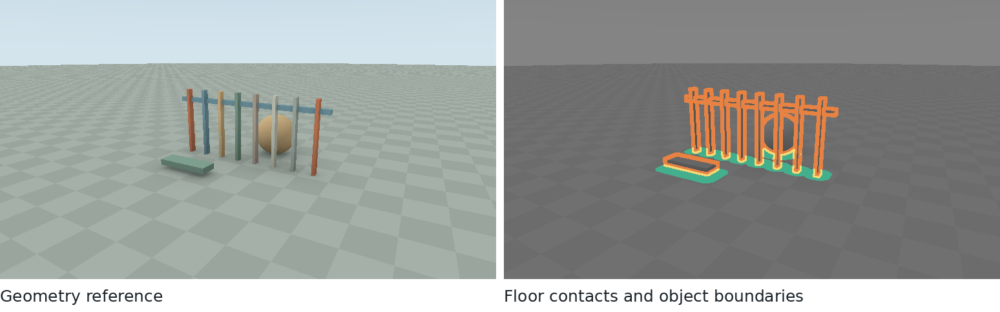
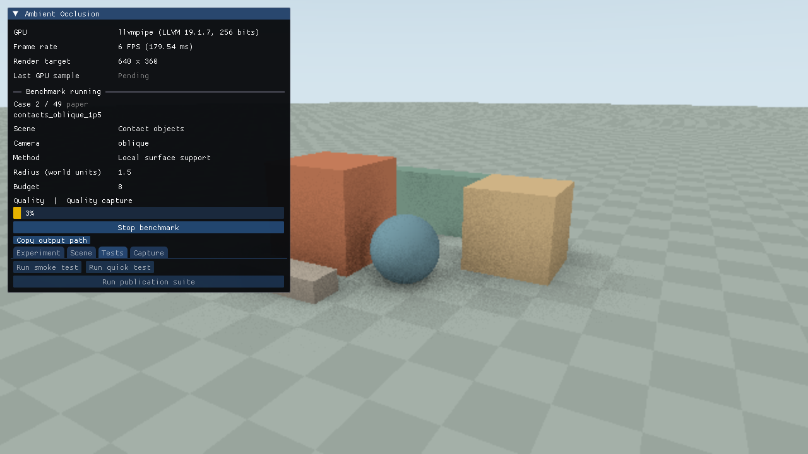

# gfx-research-ambient-occlusion

[](https://en.cppreference.com/w/cpp/20)
[](https://www.opengl.org/)
[](https://cmake.org/)

An OpenGL experiment on how much geometry a screen-space ambient occlusion shader should assume behind a visible surface. A railing and the edge of a deep wall can occupy the same few pixels. Giving both the same thickness can darken the floor behind a rail or remove contact shading beside a wall.

The shader uses four neighboring positions and normals to assign an effective thickness to a potential occluder. The experiment measures both errors against rays traced through the complete scene.


*The native viewer opens on `contacts` with `local-support`, 24 directions and radius 1.5. The screenshot was captured with software OpenGL.*

[Method](#method) · [Scenes](#scenes) · [Pilot results](#pilot-results) · [Build](#build) · [Controls](#controls) · [Live benchmark preview](#live-benchmark-preview) · [Experiments](#experiments) · [References](#references)

## Highlights

- Six methods share scene geometry, camera views and a finite occlusion radius.
- Three fixed thicknesses and a four-neighbor ablation isolate the choice of thickness from the choice of samples.
- Silhouette, floor-contact and image-border masks identify where a method gains or loses accuracy.
- The runner saves linear accessibility, reference samples, clean screenshots, error maps and raw GPU timings.

## Method

For a prospective blocker at position $P$ with normal $N$, the shader checks the left, right, upper and lower texels. A neighbor at $Q$ with normal $N_Q$ supports the surface when $|N\cdot(Q-P)|\leq\max(0.01R,2w)$ and $N\cdot N_Q\geq0.85$. Here $R$ is the AO radius and $w$ is the world-space width of a pixel at $P$. An off-screen or empty neighbor contributes zero.

Let $h$ and $v$ count supporting neighbors on the horizontal and vertical axes. The candidate uses the axis with fewer supporting neighbors.

```math
c=\frac{\min(h,v)}{2},\qquad T=R\left(0.06+0.69c^2\right).
```

Each count is 0, 1 or 2, so the rule selects exactly three thicknesses, $0.06R$, $0.2325R$ or $0.75R$. A narrow vertical rail can have two matching neighbors along its length and none across its width. The weaker-axis rule gives it the smallest thickness. A deep object viewed edge-on can produce the same evidence. The single visible layer leaves its physical thickness ambiguous.

| Method ID | Rule | Experimental role |
|---|---|---|
| `slab-thin` | $T=0.06R$ | Fixed lower endpoint |
| `slab-mid` | $T=0.25R$ | Prespecified primary comparator |
| `slab-thick` | $T=0.75R$ | Fixed upper endpoint |
| `local-support` | $c=\min(h,v)/2$ | Proposed three-level rule |
| `pooled-support` | $c=(h+v)/4$ | Same four neighbors, pooled across axes |
| `horizon` | Maximum sampled elevation per azimuth in the tangent frame | Project-specific horizon control |

Slab methods march six points along each cosine-weighted direction. The software computes accessibility as the fraction of unblocked directions. The geometric reference traces the finite-radius segment through all scene objects. The `paper` profile pools two independently shifted sets of 512 cosine-weighted directions per pixel. The viewer uses 32 directions for the interactive reference.

## Scenes

| Scene ID | Geometry | What it tests |
|---|---|---|
| `contacts` | Boxes, sphere, low step and wall | Retention of floor contact |
| `slats` | Thin rails, crosspiece and foreground shelf | Excess occlusion near thin silhouettes |
| `cavity` | Recessed steps, narrow channel and overhang | Loss of occlusion on thick geometry |
| `frustum-edge` | Objects near the frame boundary | Effect of missing screen neighbors |
| `empty-plane` | Isolated floor | Every valid pixel should have accessibility 1 |



*The right panel marks object boundaries in orange, floor contact in green and their overlap in yellow. Boundaries are widened here for legibility. The error metric uses the original mask.*

## Pilot results

This image-quality pilot used Mesa llvmpipe, 320 × 180 pixels, $R=1.5$, 24 directions and two reference shifts of 128 directions per pixel. Each number averages the three camera views of a scene. Each scene has equal weight in the final row. Smaller mean absolute error (MAE) indicates closer agreement with the geometric reference.

| Scene | Edge MAE, fixed $0.75R$ | Edge MAE, local support |
|---|---:|---:|
| Contact objects | 0.06306 | 0.06531 |
| Thin rails | 0.09659 | 0.05579 |
| Recessed steps | 0.08270 | 0.08491 |
| Frustum edge | 0.04881 | 0.04721 |
| **Mean** | **0.07279** | **0.06331** |

The upper endpoint was the best of the three tested constants **on average**. The gain on rails accounts for most of the change. The constant wins on the contact and cavity scenes for the edge metric. Across scenes, floor-contact MAE was 0.08003 with the upper endpoint, 0.07148 with pooled support and 0.06194 with local support. The large difference between scenes motivates a test on unseen geometry. [Per-view measurements](docs/pilot/views.csv) · [Pilot script](docs/pilot/measure.py)

### Research question

The primary test compares `local-support` with `slab-mid` at $R=1.5$ and 24 directions. It asks whether edge MAE falls while the increase in floor-contact MAE stays at or below 0.01. The pooled rule tests whether the horizontal and vertical grouping contributes anything beyond the four extra reads.

GTAO already uses apparent feature extent to handle thin occluders. Therrien, Levesque and Gilet identify a plausible per-sample thickness as an open design question for visibility bitmasks. The contribution under test here is the specific four-neighbor rule and the conditions under which it improves the estimate. A stronger publication test would insert it into the same bitmask implementation as a tuned constant, select that constant on separate scenes, and compare both against XeGTAO at matched GPU time. Railings at different angles would test sensitivity to the image axes. A stricter control would use an orthographic camera and two boxes with the same front face but different hidden depths. Both inputs to the shader would be identical, while the geometric reference could differ on the adjacent floor. These comparisons are proposed extensions. [References](#references)

## Build

The native viewer requires a C++20 compiler, CMake 3.25+, a desktop OpenGL 4.6 Core driver and Python 3.10+ with `venv` and `pip`. Use 64-bit Python for an x64 build. The first CMake configuration creates a private environment in the build directory and installs the packages in `requirements.txt`. Both GLAD and the publication runner use this interpreter. The headless renderer uses desktop OpenGL 4.3 and the same effect shader as the viewer.

**CLion on Windows.** Open the project, select Release, reload CMake and build the executable. Run it and choose **Tests → Run smoke test**. The first configuration fetches the base and Python packages. CMake builds the viewer library next to the executable. The viewer and the benchmark use the private interpreter recorded in the build directory.

**Windows, PowerShell and Ninja**

```powershell
cmake -S . -B out/build -G Ninja -DCMAKE_BUILD_TYPE=Release
cmake --build out/build --parallel
ctest --test-dir out/build --output-on-failure
.\out\build\gfx-research-ambient-occlusion.exe
```

**Linux, Bash and Ninja**

```bash
cmake -S . -B out/build -G Ninja -DCMAKE_BUILD_TYPE=Release
cmake --build out/build --parallel
ctest --test-dir out/build --output-on-failure
./out/build/gfx-research-ambient-occlusion
```

For a local base checkout, append `-DGFX_RESEARCH_BASE_LOCAL_PATH=../gfx-research-base` to the configure command. To select a specific base Python installation, pass its absolute interpreter path as `-DPython3_EXECUTABLE=...`. With multi-configuration generators, build with `--config Release` and use the executable in `out/build/Release`. The viewer loads shader sources from the configured source directory.

## Controls

| Tab or shortcut | Action |
|---|---|
| **Experiment** | Choose the thickness rule, 8 or 24 directions, and radius 0.75 or 1.5. Toggle **Geometry reference** for comparison. |
| **Scene** | Choose a scene and a camera (`oblique`, `reverse`, `grazing`). Switch between **Shaded scene**, **Effect only** and **Traversal work**. |
| **Tests** | Start **Run smoke test**, **Run quick test** or **Run publication suite**. The current benchmark frame appears in the same window. |
| **Stop benchmark** / **Resume benchmark** | Stop after the current rendering or export step. Resume rechecks committed cases and repeats the unfinished case. |
| **Copy output path** | Copy the absolute path of the current or most recent suite. |
| **Capture** / `F9` | Save a clean PNG while exploring the scene. Capture also offers the suite buttons. |
| `F1` or `Ctrl+H` / `Ctrl+F` | Hide or show the panel / toggle fullscreen. |
| `--capture DIRECTORY` | Render the default view, save one clean PNG to the directory and exit. |

`F9` saves under `captures/` in the launch directory. Filenames identify scene, camera, method, budget, parameter and display mode. Suites launched from the panel write to `results/publication/<profile>-<timestamp>/` inside the project.

## Experiments

### Live benchmark preview



The window shows local surface support on the contact scene at radius 1.5 with eight sample directions. This capture comes from the `paper` profile on Mesa llvmpipe. The panel identifies the case, camera, method, parameter, sampling budget and target resolution. During timing it also shows the last resolved GPU sample. The window scales the actual benchmark image to fit, preserving its aspect ratio. The PNGs collected for the paper use the test resolution and contain only the rendered image.

A run started in **Tests** returns to the interactive scene on completion or after a stop. A run started with a `--publication-*` profile opens the same window and exits on completion. Closing that window or pressing **Stop benchmark** during a command-line run returns exit code 130. To resume after reopening the application, use the same profile and output directory with `--publication-resume`.

### Run a suite

From the `cmake-build-release` directory used by CLion on Windows, the executable accepts the same publication profile flags as `gfx-research-sky`. The examples put the data under the project root.

```powershell
.\gfx-research-ambient-occlusion.exe --publication-smoke --publication-output=../results/publication/smoke
.\gfx-research-ambient-occlusion.exe --publication-quick --publication-output=../results/publication/quick
.\gfx-research-ambient-occlusion.exe --publication-suite --publication-output=../results/publication/paper
```

With no explicit output directory, the program creates a timestamped directory under the project's `results/publication/`. To resume an interrupted visual paper run in the directory used above, enter the following command.

```powershell
.\gfx-research-ambient-occlusion.exe --publication-suite --publication-output=../results/publication/paper --publication-resume
```

For an unattended run without a window, use `--study run`. These commands print the plan and run it on a GPU matching the supplied renderer name.

```powershell
.\gfx-research-ambient-occlusion.exe --study plan --profile paper
.\gfx-research-ambient-occlusion.exe --study run --profile paper --out ../results/publication/rx9070xt --expect-renderer "9070 XT"
```

| Profile | Quality resolution | Timing resolution | Warm-up draws per block | Blocks × measured draws per method and condition |
|---|---|---|---:|---:|
| `smoke` | 144 × 80 | 144 × 80 | 2 | 1 × 3 |
| `quick` | 320 × 180 | 640 × 360 | 5 | 3 × 10 |
| `paper` | 640 × 360 | 1280 × 720 and 1920 × 1080 | 12 | 5 × 40 |

The `paper` matrix contains **25 quality cases, 300 method-and-budget evaluations and 28,800 timed draws**. Four challenge scenes use both radii and three cameras. The null scene uses one camera and one radius. GPU timings cover the contact and rail scenes at radius 1.5.

`plan` prints the case matrix without opening a graphics context. With `run`, `--expect-renderer` checks a substring of the active renderer name. Set it to the target card, or omit it to accept the default adapter. Linux defaults to EGL and supports `--device INDEX`. Windows uses the default OpenGL context. Use `--hardware-note` for a driver or clock note. To continue an interrupted headless run, repeat the original command with `--resume`. It verifies completed cases and checks the plan, measurement source hash and device.

### Analyze results

Run these from `cmake-build-release`. To use the run created with `--publication-suite` in the example above, substitute `../results/publication/paper` for `../results/publication/rx9070xt`.

```powershell
.\gfx-research-ambient-occlusion.exe --study analyze ../results/publication/rx9070xt
.\gfx-research-ambient-occlusion.exe --study analyze ../results/publication/rx9070xt --paper ../../gfx-research-ambient-occlusion-paper
```

The first command checks the captures against their hashes and recomputes quality metrics from the linear arrays. The second also imports the figure, LaTeX fragment and summary tables into the matching manuscript extracted alongside the project.

| Output in the run directory | Contents |
|---|---|
| `manifest.json` | Renderer, presentation mode, runtime versions, command, source hash, seed, exact case matrix and completion status |
| `quality/CASE/reference.npz` | Linear accessibility, both reference shifts, positions, IDs, normals, diagnostic fields and masks |
| `quality/CASE/reference_scene.png`, `reference_signal.png`, `regions.png` | Shaded reference, isolated reference signal and metric masks |
| `quality/CASE/bBUDGET/METHOD/` | `scene.png`, `signal.png`, `error.png` and full-precision `raw.npz` with diagnostic channels |
| `timing/CASE/timing.csv` | Individual GPU elapsed times in nanoseconds with block, method order and sample index |
| `report/quality.csv`, `report/timing.csv` | All per-condition quality rows and raw timing samples |
| `report/paired_quality.csv`, `report/timing_blocks.csv`, `report/paired_timing.csv` | Paired quality differences, block medians and p95 timings, paired timing differences and intervals |
| `report/summary.json`, `report/comparison.png`, `report/results.tex` | Primary comparison, fixed comparison panel and manuscript fragment |

`edge_mae` measures absolute error on both valid sides of a four-neighbor ID transition involving a solid object. `contact_mae` covers floor pixels within $0.20R$ of a solid. `border_mae` covers the outer 5% of the image in either dimension. These regions can overlap. In `regions.png`, the red, green and blue channels encode edge, contact and border. White in `error.png` represents absolute accessibility error of 0.25 or greater. The arrays retain the unclipped linear values. Empty masks have zero pixels and a blank metric.

Each timing query encloses one effect draw with diagnostics disabled. Geometry, reference, readback, PNG encoding, preview composition and the interface are outside the query. Presentation can affect GPU scheduling between batches. Compare timings from the same presentation mode, case and block. The panel FPS includes the entire window update.

### Verify the reference and reproduce the pilot

From the project root, use the interpreter recorded by CMake. Set the build directory to the one you configured (`cmake-build-release` for the CLion examples or `out/build` for the Ninja examples).

```powershell
$studyPython = (Get-Content -Raw .\cmake-build-release\publication-python.txt).Trim()
& $studyPython tests/test_reference.py
& $studyPython docs/pilot/measure.py --out runs/pilot-views.csv
```

The reference check compares the GPU output with independent double-precision intersections on the default scene. The software-rendered smoke suite completed 30 method evaluations on five scenes, including the isolated-plane control. The reference check verified 221 primary rays and three independent accessibility estimates. The pilot command reproduces the table's input using seed 17. It writes one row per scene, camera and method. The archived pilot contains image-quality data only. The `paper` profile is ready for a separate target-GPU run.

## Project structure

| Location | Responsibility |
|---|---|
| [study.json](study.json) | Shared scene and method IDs, budgets, candidate and baseline |
| [src/main.cpp](src/main.cpp) and [src/publication.cpp](src/publication.cpp) | Executable entry points and build-local interpreter selection |
| [src/viewer.cpp](src/viewer.cpp) and [tools/viewer.py](tools/viewer.py) | GLFW/ImGui panel, clean captures and live benchmark frames on the window's GL context |
| [cmake/PublicationPython.cmake](cmake/PublicationPython.cmake) | Prepare and verify the build-local publication environment |
| [shaders/effect.frag](shaders/effect.frag) | Slab tests, surface support and the horizon control |
| [shaders/reference.frag](shaders/reference.frag) | Finite-radius ray-traced accessibility |
| [shaders/objects.glsl](shaders/objects.glsl) and [shaders/sampling.glsl](shaders/sampling.glsl) | Scene primitives, contact masks and cosine-weighted directions |
| [tools/study.py](tools/study.py) and [tools/protocol.py](tools/protocol.py) | Suite execution, case matrix and recoverable runs |
| [tools/renderer.py](tools/renderer.py), [tools/metrics.py](tools/metrics.py) and [tools/report.py](tools/report.py) | Offscreen rendering, metrics, analysis and paper export |
| [tests/test_reference.py](tests/test_reference.py) | Independent geometric checks |

## References

1. Jorge Jimenez, Xian-Chun Wu, Angelo Pesce and Adrian Jarabo. *Practical Realtime Strategies for Accurate Indirect Occlusion*. Activision Research, 2016. Sections on GTAO and thin occluders. [Technical report](https://research.activision.com/publications/archives/atvi-tr-16-01practical-realtime-strategies-for-accurate-indirect-occlusion)
2. Olivier Therrien, Yannick Levesque and Guillaume Gilet. *Screen Space Indirect Lighting with Visibility Bitmask*. The Visual Computer 39, 5925–5936, 2023. Finite-thickness samples and local thickness estimation as future work. [Paper](https://doi.org/10.1007/s00371-022-02703-y) · [Open manuscript](https://arxiv.org/html/2301.11376v2)
3. Intel GameTechDev. *XeGTAO*. The “Thin occluder conundrum” section documents a practical thickness heuristic alongside its failure cases. [Implementation and technical notes](https://github.com/GameTechDev/XeGTAO#thin-occluder-conundrum)
4. Louis Bavoil, Miguel Sainz and Rouslan Dimitrov. *Image-Space Horizon-Based Ambient Occlusion*. ACM SIGGRAPH Talks, 2008. Horizon-based methods provide context for the local control. [Paper](https://doi.org/10.1145/1401032.1401061)
